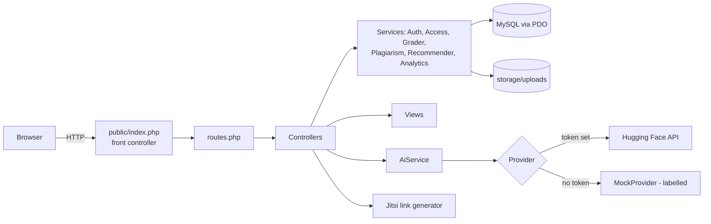

# Architecture

Three layers as in the thesis: browser UI, PHP application, MySQL. A front controller (`public/index.php`) maps `METHOD /path` to a controller method via `src/routes.php`. Controllers stay thin; logic lives in `src/` services (`Auth`, `Access`, `Grader`, `Plagiarism`, `Recommender`, `Analytics`, `AiService`). Views are plain PHP templates in `views/`. Uploads live in `storage/uploads` (outside the web root) and are served only through authorised download routes.

Editable source: `docs/diagrams/architecture.mmd` (Mermaid; GitHub renders it, or use mermaid.live).

**Deployment shapes:** (1) XAMPP: project in `htdocs/eduverse`, root `.htaccess` forwards to `public/`, `APP_BASE_PATH=/eduverse`; (2) `php -S ... -t public public/index.php` with an empty base path. All URLs are built with `url()`, redirects go through `redirect()`, and JavaScript reads the base from a `<meta name="base">` tag, so both shapes work. `Schema` applies `schema.sql` and tracked migrations (the updater).

**AI failure handling:** providers never throw to the UI; they return an `AiResult` with a status (`rate_limited`, `auth_error`, `unavailable`, `error`, `local_rate_limit`). Every request is logged in `ai_interactions` with `is_mock`.
