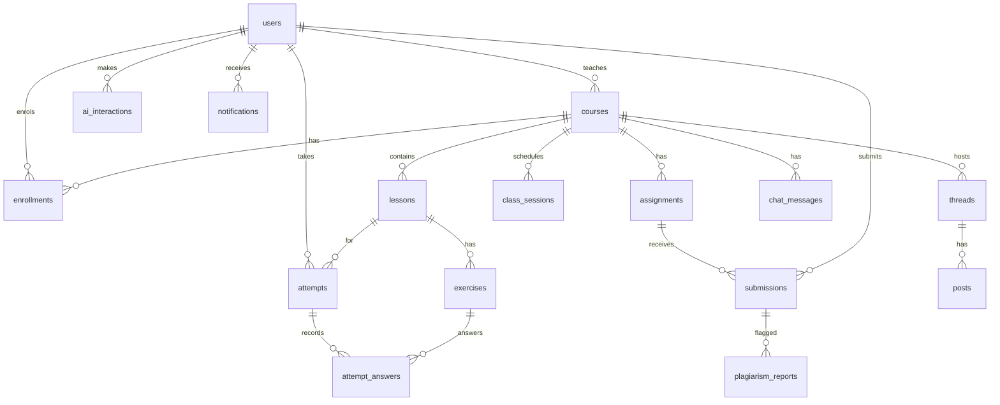

# Database design

MySQL/MariaDB, InnoDB, utf8mb4. Schema: `database/schema.sql` (idempotent; applied by `php database/migrate.php`).

Source: `docs/diagrams/erd.mmd`.

## Mapping from the thesis ERD

| Thesis table | Here |
|---|---|
| tblusers, tbllecturer, tblstudent | `users` (role column; hashed password) |
| tbllesson | `lessons` (chapter, title, category, file) |
| tblexercise | `exercises` (MCQ, answer A-D) |
| tblscore | `attempts` |
| tblstudentquestion | `attempt_answers` |
| tblautonumbers | dropped (native AUTO_INCREMENT) |
| (not in thesis ERD) | `courses`, `enrollments`, `assignments`, `submissions`, `plagiarism_reports`, `class_sessions`, `threads`, `posts`, `chat_messages`, `ai_interactions`, `notifications`, `login_attempts` |
